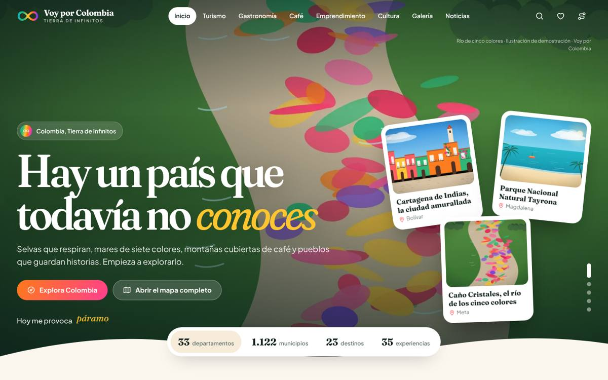
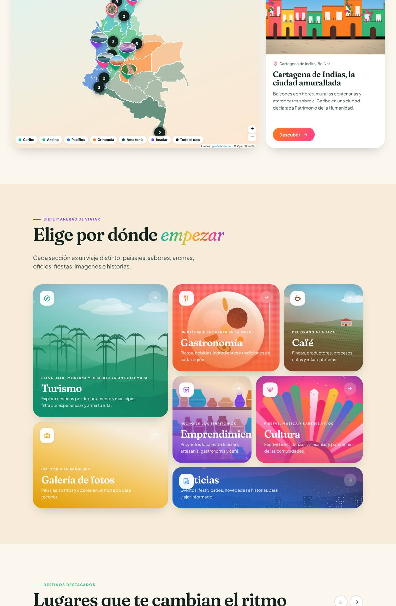
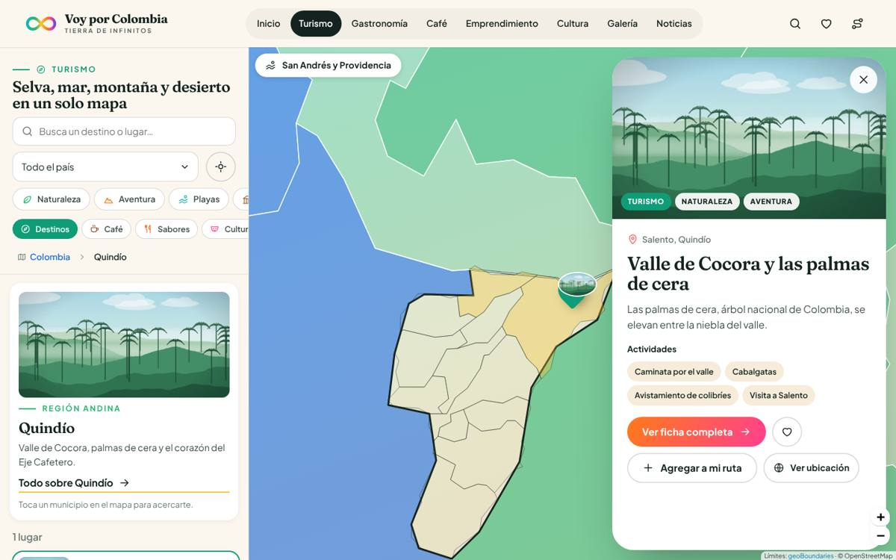
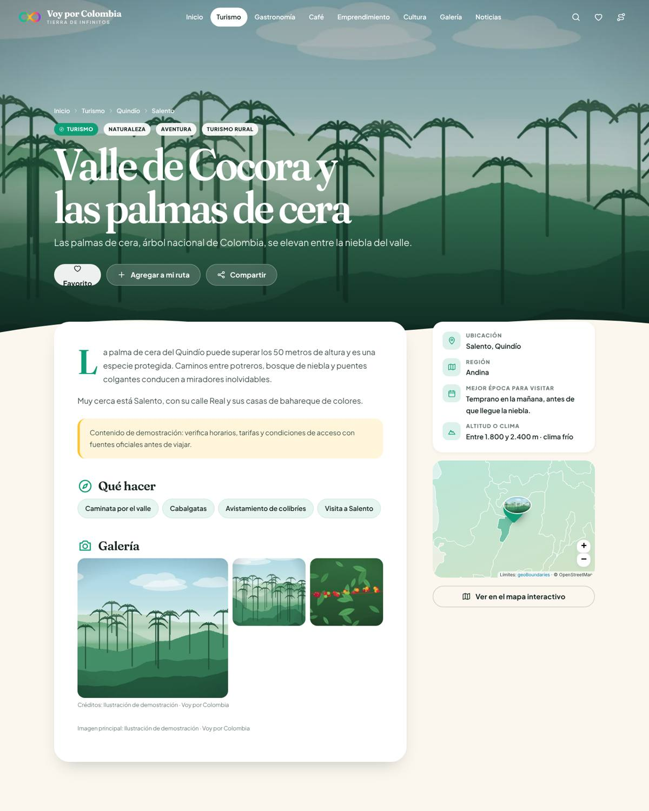
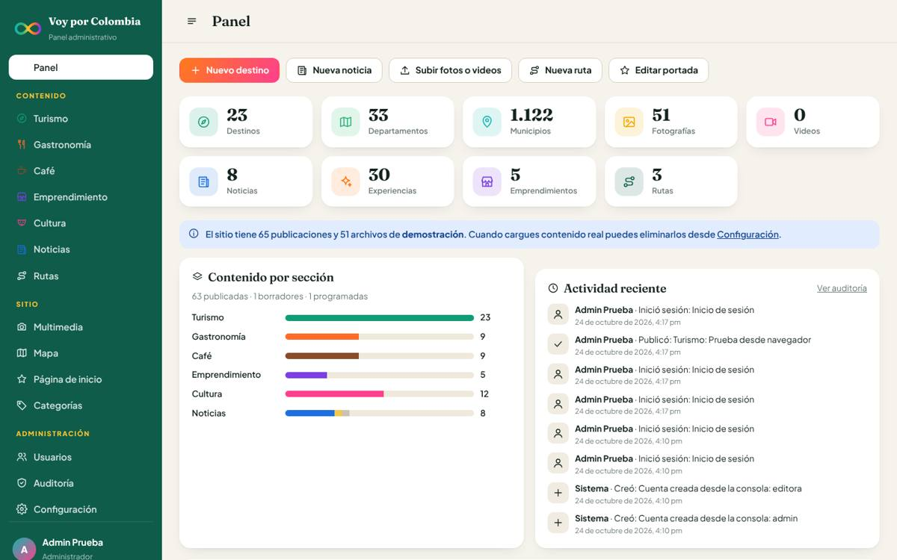
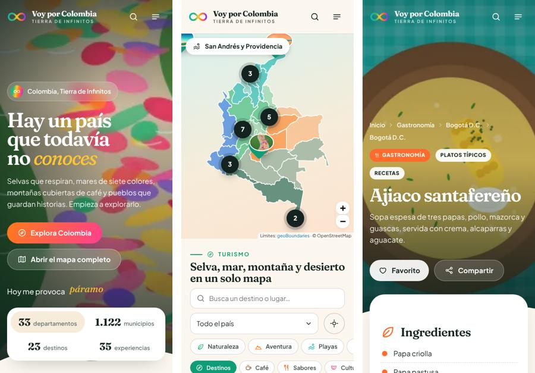

# Voy por Colombia · Colombia, Tierra de Infinitos

Plataforma turística interactiva para descubrir la diversidad turística, gastronómica, cafetera, cultural y emprendedora de Colombia. Incluye:

- Un sitio público con identidad visual propia.
- Un mapa con límites geográficos reales de los 33 departamentos y los 1.122 municipios.
- Un panel administrativo privado para gestionar todo el contenido sin tocar el código.



| Mapa y categorías | Explorador de Turismo |
|---|---|
|  |  |
| **Ficha de destino** | **Panel administrativo** |
|  |  |



---

## 1. Qué incluye

### Sitio público

| Página | Ruta | Funcionalidad |
|---|---|---|
| Inicio | `/` | Portada cinematográfica con imágenes rotativas o video, mapa interactivo con panel de lugar, mosaico de 7 categorías, destinos destacados, joyas poco conocidas, experiencias, próximas festividades, rutas, noticias, galería y cierre |
| Turismo | `/turismo` | Explorador **Colombia → departamento → municipio → destino**: zoom, marcadores con foto agrupados, filtros por categoría y por capa (destinos, café, sabores, cultura, emprendimientos), búsqueda, «cerca de mí», panel multimedia, favoritos y ruta personal dibujada en el mapa |
| Ficha | `/turismo/{slug}` (y equivalentes por sección) | Foto principal, galería con visor, videos (archivo o YouTube/Vimeo), audios, PDF, datos clave, mapa de ubicación, lugares cercanos (distancia real) y botón de compartir |
| Gastronomía | `/gastronomia` | Mosaico de platos; filtros por región, departamento, municipio, tipo y búsqueda; fichas con ingredientes, preparación paso a paso e historia |
| Café | `/cafe` | Proceso «del grano a la taza», mapa cafetero, fincas, productores, catas y rutas |
| Emprendimiento | `/emprendimiento` | Directorio con filtros y buscador; fichas con productos y contacto |
| Cultura | `/cultura` | Calendario mensual de eventos, próximas fiestas y expresiones culturales filtrables |
| Galería | `/galeria` | Mosaico tipo revista; filtros por categoría, colección, departamento, municipio y tipo; visor con teclado y gestos; carga progresiva |
| Noticias | `/noticias` | Noticia destacada, recientes, búsqueda, filtros y paginación |
| Otras | `/buscar`, `/departamentos/{slug}`, `/rutas`, `/rutas/{slug}`, `/favoritos`, `/mi-ruta` | Buscador global (también como paleta con la tecla `/`), páginas por departamento, rutas curadas, favoritos y planificador de ruta compartible por enlace |

Otras características del sitio público:

- **Favoritos y rutas personales:** se guardan en el navegador del visitante (`localStorage`), sin necesidad de cuentas públicas. Las rutas se comparten con un enlace del tipo `/mi-ruta?ids=…`.
- **Responsive y accesible:** funciona en computador, tableta y celular. Incluye enlace para saltar al contenido, textos alternativos, navegación con teclado, foco visible y `prefers-reduced-motion`.

### Panel administrativo (`/admin`)

| Módulo | Qué permite |
|---|---|
| Dashboard | Totales de destinos, departamentos, municipios, fotografías, videos, noticias, experiencias, emprendimientos y rutas. También accesos rápidos, contenido por sección y estado, actividad reciente y avisos (contenido demo, destinos sin coordenadas) |
| Contenido por sección | Turismo, Gastronomía, Café, Emprendimiento, Cultura y Noticias por separado. Permite crear, editar, publicar, despublicar, programar, archivar y eliminar (con confirmación escrita). Cada sección tiene sus propios campos (actividades, ingredientes, preparación, contacto, fechas de evento, etc.) |
| Centro multimedia | Carga múltiple (arrastrar y soltar, con barra de progreso), validación de tipo, tamaño y contenido real, optimización a WebP, metadatos (título, texto alternativo, crédito, licencia, fuente, ubicación, colección) y videos de YouTube o Vimeo por enlace. Muestra dónde se usa cada archivo y permite reutilizarlo con el selector multimedia de los formularios |
| Gestión del mapa | Mapa con todos los marcadores, que se pueden arrastrar para corregir la ubicación. Incluye la lista de publicaciones sin coordenadas y la edición de región, capital, descripción e imagen de cada departamento. En los formularios hay un selector de coordenadas (clic en el mapa o «centro del municipio») |
| Página de inicio | Textos de portada, imágenes rotativas o video, palabras rotativas, textos de cada bloque, bloques de categorías (título, lema, imagen, orden, visibilidad) y orden de los destacados |
| Rutas | Rutas curadas con paradas ordenables y notas por parada |
| Categorías | Nombre, ícono, color y orden por sección |
| Usuarios (solo administradores) | Crear, editar, cambiar rol, restablecer contraseña, activar y desactivar. Desactivar una cuenta o cambiarle la contraseña cierra sus sesiones de inmediato |
| Vista previa | Muestra cualquier publicación (borrador, programada o archivada) con el diseño público. Solo para usuarios autenticados |
| Auditoría (solo administradores) | Registro de ingresos, creaciones, ediciones, publicaciones, archivados, eliminaciones y cargas, con usuario, fecha e IP |
| Configuración (solo administradores) | Nombre, lema, pie de página, correo y redes sociales. También permite eliminar todo el contenido de demostración |

---

## 2. Arquitectura

**Elección:** el repositorio estaba vacío. Se eligió **PHP 8 + MySQL/MariaDB**, la misma base tecnológica de proyectos anteriores en XAMPP y la que ofrece la mayoría de los hostings colombianos. Se complementa con **JavaScript sin frameworks** y **Leaflet** para la cartografía. No requiere Composer, Node ni ningún paso de compilación: se copia la carpeta y funciona. Para desarrollo y pruebas también funciona con **SQLite** sin instalar nada.

```
voy-por-colombia/
├── app/
│   ├── bootstrap.php          Arranque: entorno, autoload, errores, zona horaria
│   ├── routes.php             Todas las rutas (públicas, API y panel)
│   ├── Sections.php           Secciones y campos específicos de cada tipo de publicación
│   ├── helpers.php            Escape HTML, URLs, fechas en español, imágenes responsive…
│   ├── Core/                  Router, Database (PDO), Auth, Csrf, Session, RateLimiter,
│   │                          Audit, MediaProcessor, Markdown seguro, Migrator, View
│   ├── Models/                Entry, Media, Geo, Category, Route, User, Setting, SectionInfo, Demo
│   ├── Controllers/           PublicController, ApiController y Admin/* (un controlador por módulo)
│   └── Views/                 layouts/, partials/, public/, admin/
├── database/
│   ├── migrations/            Esquema versionado (compatible MySQL y SQLite)
│   ├── seeds/                 BaseSeeder (datos geográficos y catálogos) y DemoSeeder (demostración)
│   ├── seeds/demo-media/      51 ilustraciones originales de demostración (WebP)
│   └── data/municipios.csv    1.122 municipios con departamento y coordenadas
├── public/                    ← RAÍZ WEB (lo único que debe servir el servidor)
│   ├── index.php              Controlador frontal
│   ├── assets/                css/, js/, fuentes, íconos, Leaflet y MarkerCluster (locales)
│   ├── data/geo/              departamentos.geojson y municipios/{departamento}.geojson
│   └── uploads/               Archivos subidos (PHP deshabilitado por .htaccess)
├── storage/                   Base SQLite, sesiones y registros (no accesible por web)
├── bin/                       install.php, migrate.php, create-admin.php, remove-demo.php
├── tests/run.php              Pruebas de extremo a extremo (73 verificaciones)
└── tools/                     Scripts para regenerar los datos geográficos y las ilustraciones
```

### Base de datos

| Tabla | Contenido |
|---|---|
| `roles`, `users` | Cuentas, rol (`admin`/`editor`), hash de contraseña, estado y versión de sesión |
| `regions`, `departments`, `municipalities` | Regiones naturales → 33 departamentos → 1.122 municipios (con coordenadas) |
| `entries` | Publicaciones de todas las secciones. Relaciones: departamento, municipio, coordenadas, portada, estado, fecha de publicación, eventos, destacados y campos específicos en `meta` (JSON) |
| `categories`, `entry_categories` | Categorías por sección (relación N:M) |
| `media`, `entry_media` | Biblioteca multimedia reutilizable y su vínculo ordenado con publicaciones |
| `collections` | Colecciones de la galería |
| `routes`, `route_stops` | Rutas curadas y sus paradas ordenadas |
| `sections`, `settings` | Presentación editable de secciones y configuración de la portada y el sitio |
| `audit_log`, `login_attempts` | Auditoría y control de intentos de ingreso |

El contenido se clasifica por sección y su estructura base es la misma. Así el mapa, el buscador, la galería y los destacados consultan una sola tabla, y cada sección conserva sus campos propios. Los archivos pesados nunca se guardan en la base de datos: se guardan en `public/uploads/AAAA/MM/` con nombres aleatorios.

---

## 3. Instalación

### Requisitos

- PHP **8.1 o superior** con las extensiones `pdo_mysql` (o `pdo_sqlite`), `gd` (con WebP), `fileinfo`, `mbstring` y `intl` (recomendada). XAMPP 8.x las trae activas.
- MySQL 5.7+ o MariaDB 10.3+ (o SQLite para desarrollo).
- Apache con `mod_rewrite`, o cualquier servidor que envíe las peticiones a `public/index.php`.

### Opción A — Prueba rápida local (SQLite, sin instalar base de datos)

```bash
cp .env.example .env                 # DB_DRIVER=sqlite por defecto
php bin/install.php --demo           # crea tablas, departamentos, municipios y contenido demo
php bin/create-admin.php             # crea la primera cuenta (pide la contraseña de forma oculta)
php -S localhost:8000 -t public public/index.php
```

Abre <http://localhost:8000> y el panel en <http://localhost:8000/admin>.

### Opción B — XAMPP con MySQL/MariaDB

1. Copia la carpeta a `C:\xampp\htdocs\voy-por-colombia`.
2. En phpMyAdmin crea la base `voy_por_colombia` con cotejamiento `utf8mb4_unicode_ci`.
3. Copia `.env.example` como `.env` y ajusta:
   ```ini
   APP_URL=http://localhost/voy-por-colombia
   APP_BASE_PATH=/voy-por-colombia
   DB_DRIVER=mysql
   DB_NAME=voy_por_colombia
   DB_USER=root
   DB_PASS=
   ```
4. En la consola de XAMPP («Shell»), dentro de la carpeta del proyecto:
   ```bash
   php bin/install.php --demo
   php bin/create-admin.php
   ```
5. Abre <http://localhost/voy-por-colombia>. El `.htaccess` de la raíz envía todo a `public/` y bloquea `app/`, `storage/`, `database/`, `.env`, etc.

> Para no cargar datos de demostración, ejecuta `php bin/install.php` sin `--demo`.

### Producción

- Apunta el **DocumentRoot** directamente a `public/`. Es lo más seguro. Si no es posible, el `.htaccess` raíz lo protege.
- Activa HTTPS y define `SESSION_SECURE=true`. Descomenta la redirección a HTTPS en `public/.htaccess`.
- Usa `APP_DEBUG=false`.
- El usuario del servidor web necesita **escribir** en `storage/` y `public/uploads/`.
- Ajusta en `php.ini` `upload_max_filesize` y `post_max_size` según el tamaño máximo de video que quieras permitir (por ejemplo `256M`).
- Haz copias de seguridad de la base de datos **y** de `public/uploads/`.
- Para actualizar a una versión nueva, ejecuta `php bin/migrate.php`, que aplica solo las migraciones pendientes.

### Variables de entorno (`.env`)

| Variable | Uso |
|---|---|
| `APP_NAME`, `APP_URL`, `APP_BASE_PATH` | Nombre, URL pública y subcarpeta (si aplica) |
| `APP_DEBUG` | `true` solo en desarrollo (muestra detalles de errores) |
| `APP_TIMEZONE` | Por defecto `America/Bogota` |
| `DB_DRIVER` | `mysql` o `sqlite` |
| `DB_HOST`, `DB_PORT`, `DB_NAME`, `DB_USER`, `DB_PASS` | Conexión MySQL/MariaDB |
| `DB_PATH` | Archivo SQLite (por defecto `storage/database.sqlite`) |
| `SESSION_LIFETIME_MINUTES` | Inactividad máxima antes de cerrar la sesión (120) |
| `SESSION_SECURE`, `TRUST_PROXY` | Cookies solo por HTTPS / confiar en `X-Forwarded-*` detrás de un proxy |
| `UPLOAD_MAX_IMAGE_MB`, `UPLOAD_MAX_VIDEO_MB`, `UPLOAD_MAX_AUDIO_MB`, `UPLOAD_MAX_DOC_MB`, `IMAGE_QUALITY` | Límites de carga y calidad WebP |
| `MAP_TILE_URL`, `MAP_TILE_ATTRIBUTION` | Capa opcional de calles y relieve (ver sección 7) |
| `SETUP_TOKEN` | Instalador web de la primera cuenta (ver sección 4) |

`.env` está en `.gitignore`: **nunca** lo subas al repositorio.

---

## 4. Primera cuenta administrativa (de forma segura)

El código no contiene ninguna contraseña ni cuenta predefinida.

**Con consola (recomendado):**

```bash
php bin/create-admin.php
# o sin preguntas:
php bin/create-admin.php --name="Nombre Apellido" --email=correo@dominio.co --username=usuario
```

La contraseña se pide oculta y no queda en el historial. Debe tener mínimo 10 caracteres y combinar letras y números. Para automatizar se puede pasar en la variable de entorno `VPC_ADMIN_PASSWORD`. Con `--role=editor` se crean editores.

**Sin consola (hosting compartido):**

1. Define en `.env` un `SETUP_TOKEN` largo y aleatorio (mínimo 24 caracteres).
2. Visita `/admin/instalar?token=ESE_TOKEN` y crea la cuenta.
3. El instalador solo funciona mientras **no exista ninguna cuenta**. Después devuelve 404. Aun así, **borra el `SETUP_TOKEN`** del `.env`.

Las demás cuentas se crean desde **Panel › Usuarios**.

### Roles y permisos

| Permiso | Administrador | Editor |
|---|:-:|:-:|
| Contenido (crear, editar, publicar, archivar, eliminar) | ✔ | ✔ |
| Multimedia, mapa, portada, rutas, categorías | ✔ | ✔ |
| Usuarios, auditoría, configuración y borrado de demo | ✔ | ✘ |

Los permisos se verifican **en el servidor** en cada acción (`Auth::require` / `Auth::can`). Ocultar los botones en el menú es solo una ayuda visual. Siempre debe existir al menos un administrador activo.

---

## 5. Seguridad implementada

- **Contraseñas:** se guardan con `password_hash` (Argon2id cuando está disponible; si no, bcrypt) y se actualizan solas al ingresar si el algoritmo mejora.
- **Sesiones:** cookies `HttpOnly`, `SameSite=Lax` y `Secure` con HTTPS. El ID de sesión se regenera al ingresar. Se cierran por inactividad y quedan invalidadas al cambiar la contraseña, el rol o al desactivar la cuenta.
- **CSRF:** token obligatorio en **todas** las peticiones POST. Una petición sin token recibe el error 419.
- **Intentos de ingreso:** bloqueo de 15 minutos tras 5 intentos fallidos por cuenta (o 20 por IP). Los mensajes no revelan qué cuentas existen.
- **Inyección SQL:** todas las consultas usan PDO con sentencias preparadas reales (sin emulación). Los comodines de búsqueda se escapan.
- **XSS:** toda salida pasa por `e()` (`htmlspecialchars`). El editor de texto usa un Markdown reducido que **escapa el HTML** y solo admite enlaces `http(s)`. Además hay una *Content Security Policy* sin scripts en línea, junto con `X-Frame-Options`, `nosniff` y `Referrer-Policy`.
- **Cargas de archivos:**
  - Se valida el error de carga, el tamaño y el tipo MIME **real** (finfo), que debe coincidir con la extensión.
  - Las imágenes se verifican con `getimagesize`, con un límite de 50 MP, y se **recodifican** con GD. Así se eliminan los metadatos EXIF y cualquier contenido incrustado.
  - Los archivos reciben nombres aleatorios.
  - En `public/uploads/.htaccess` PHP y los scripts quedan deshabilitados.
  - No se aceptan SVG de usuarios.
- **Auditoría** de las acciones administrativas importantes.

---

## 6. Pruebas

```bash
php tests/run.php
```

Las pruebas crean una base de datos temporal, levantan el servidor embebido y verifican **73 escenarios**. No tocan la base de datos del proyecto. Cubren:

- Todas las páginas públicas.
- Visibilidad de borradores, contenido programado y archivado.
- Inyección SQL y XSS.
- CSRF y bloqueo por intentos.
- Carga de imágenes válidas, PHP disfrazado y extensiones falsas.
- Creación de una publicación y su aparición en la web y en el mapa.
- Validaciones, vista previa, archivar, publicar y eliminar.
- Cambios de portada y galería.
- Permisos del editor (incluidos los POST directos a rutas de administrador).
- Desactivación de cuentas con cierre de sesión inmediato, y auditoría.

Contra MySQL/MariaDB (la base indicada **se borra y se recrea**):

```bash
TEST_DB_DRIVER=mysql TEST_DB_NAME=vpc_test TEST_DB_USER=usuario TEST_DB_PASS=clave php tests/run.php
```

---

## 7. Mapa, datos geográficos y servicios externos

- **Límites de departamentos y municipios:** [geoBoundaries](https://www.geoboundaries.org) (gbOpen, COL ADM1/ADM2), derivados de **OpenStreetMap** bajo licencia **ODbL 1.0**. La atribución aparece en el mapa y en el pie de página. Se simplificaron para la web y cada municipio se asoció a su departamento por relación espacial. Para regenerarlos se usa `tools/geo/build_geo.py` (instrucciones en el encabezado del script).
- **Biblioteca cartográfica:** Leaflet 1.9.4 y Leaflet.markercluster 1.5.3, servidas localmente (licencias BSD-2 y MIT incluidas).
- **Fuentes:** Fraunces y Plus Jakarta Sans, servidas localmente (licencia OFL, incluida).
- **No se requiere ninguna clave ni API externa.** El mapa funciona solo con los polígonos.
- **Capa opcional de calles y relieve:** define `MAP_TILE_URL` y `MAP_TILE_ATTRIBUTION` en `.env`. Aparece entonces el botón «Relieve y calles» y la política de seguridad permite ese dominio. Los servidores públicos de OpenStreetMap tienen una [política de uso](https://operations.osmfoundation.org/policies/tiles/) que no admite tráfico alto. Para producción conviene un proveedor de teselas (MapTiler, Stadia, Thunderforest, etc.) con su propia clave en la URL.
- **Videos de YouTube y Vimeo:** se incrustan con `youtube-nocookie.com` y `player.vimeo.com`. No requieren clave.

---

## 8. Contenido de demostración

`php bin/install.php --demo` carga contenido **claramente identificado** como demostración (`is_demo = 1`):

- **51 ilustraciones originales** generadas por código (`tools/demo-art/`). No son fotografías ni obras de terceros, y llevan el crédito «Ilustración de demostración».
- **Destinos, platos y festividades reales** descritos de forma general, con una nota que invita a verificar condiciones y fechas. Las fechas de eventos son de referencia.
- **Emprendimientos, la finca y las noticias son ficticios.** En el sitio se muestran con la etiqueta «Demostración» y sus datos de contacto usan `example.com`.

Para retirarlo: **Panel › Configuración › Eliminar demostración**, o `php bin/remove-demo.php`. Lo que hayas creado o editado (desmarcando «Mantener como demostración») se conserva.

---

## 9. Estado y pendientes

**Verificado en este entorno:**

- Instalación limpia con SQLite y con MariaDB 10.11 (modo `ONLY_FULL_GROUP_BY`). Las 73 pruebas pasan en ambos motores.
- Apache 2.4 con `mod_rewrite` en subcarpeta (como XAMPP): rutas, recursos, sesión, bloqueo de carpetas internas y de PHP en `uploads`.
- Revisión visual en escritorio (1440 px) y móvil (390 px) con Chromium.
- Pruebas en navegador del explorador (departamento → municipio → destino), el selector multimedia, el selector de coordenadas y la publicación desde el panel. No hubo errores de JavaScript.

**Requiere acción de tu parte:**

- **Fotografías y videos reales:** las imágenes actuales son ilustraciones de demostración. Sube fotografías con derechos de uso y registra su crédito y licencia en el centro multimedia.
- **Imágenes de referencia de diseño:** no llegaron con la solicitud. Si las compartes, se puede ajustar la identidad visual a ellas.
- **Emprendimientos y noticias reales,** redes sociales y correo de contacto (Configuración).
- **Revisión de descripciones y fechas** por parte del equipo editorial antes del lanzamiento.
- **Servidor de producción:** HTTPS, límites de carga en `php.ini`, copias de seguridad y, si se desea, la capa de teselas.
