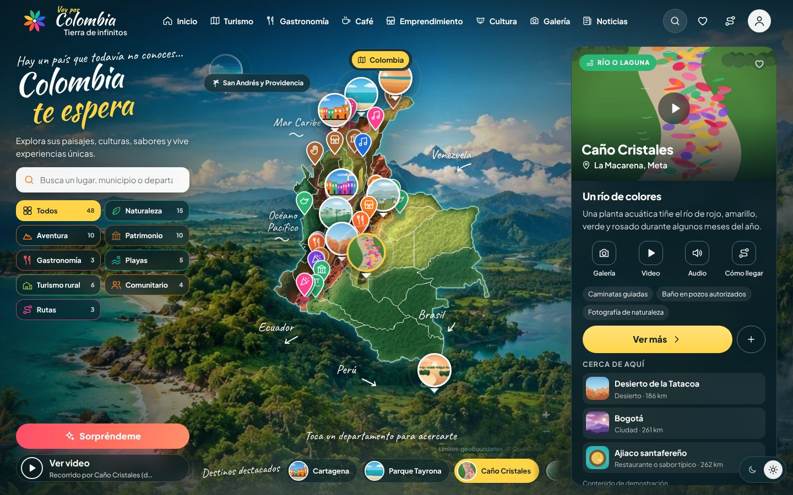
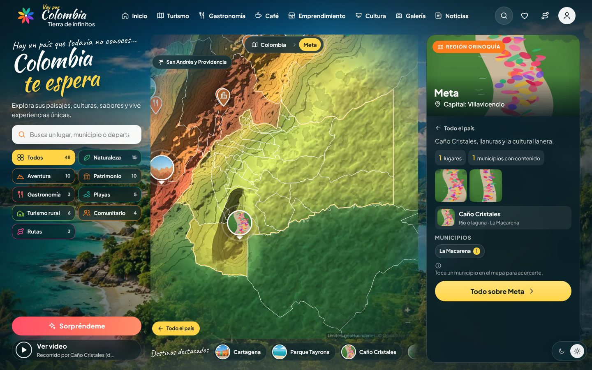
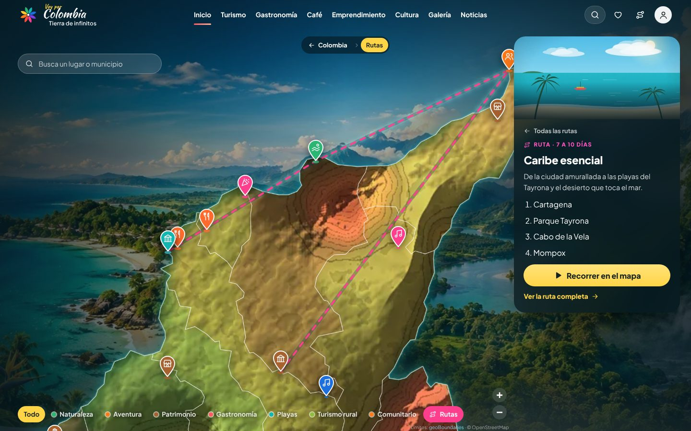
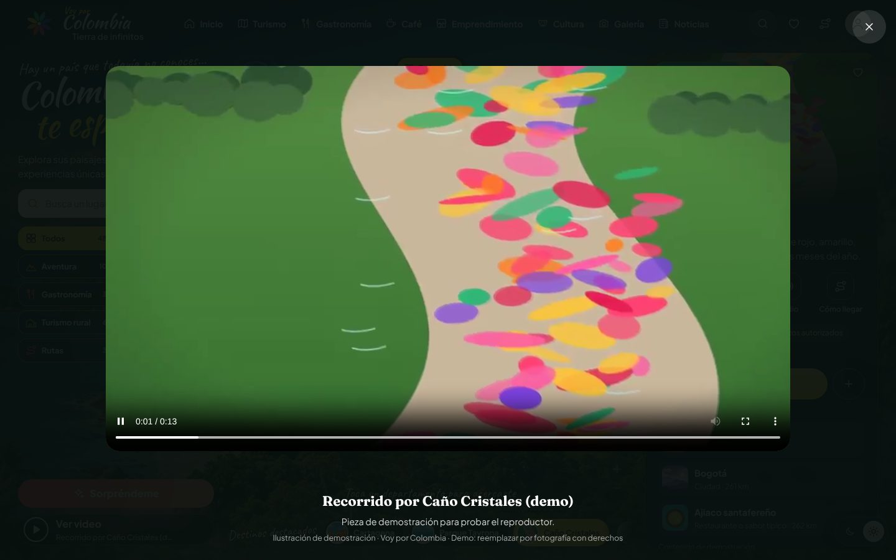
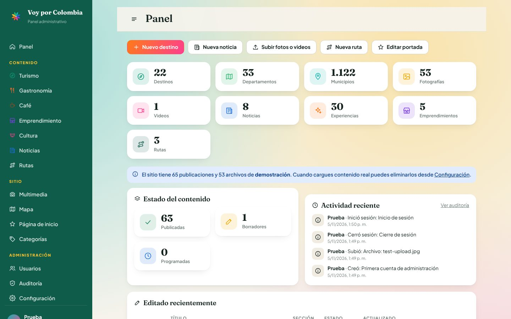
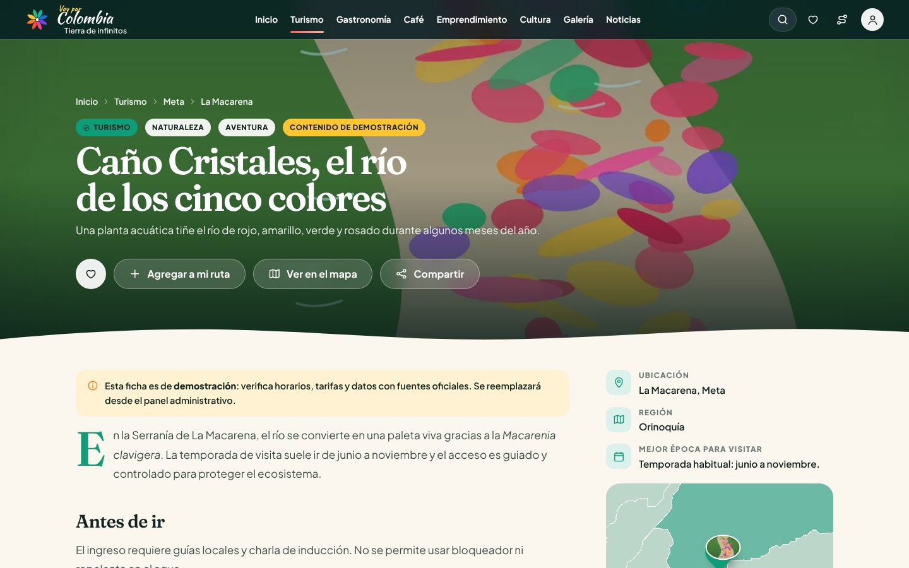
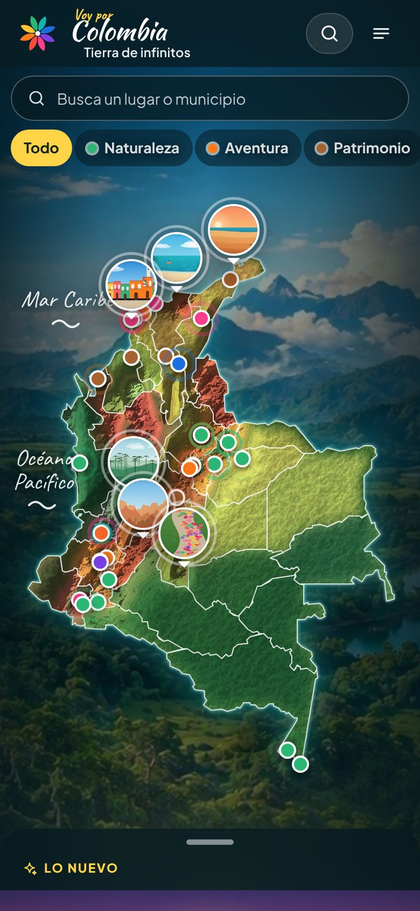

# Voy por Colombia · Colombia, Tierra de Infinitos

Plataforma turística interactiva para descubrir la diversidad turística, gastronómica, cafetera, cultural y emprendedora de Colombia.

- **Inicio de una sola pantalla:** el mapa interactivo es el protagonista y todo ocurre dentro de él, sin que la página se desplace.
- **Límites geográficos reales:** los 33 departamentos y los 1.122 municipios.
- **Panel administrativo privado:** se gestiona todo el contenido sin tocar el código.

> **¿Solo quieres verlo en XAMPP?** Copia la carpeta en `htdocs`, enciende **solo Apache** y abre <http://localhost/voy-por-colombia>. Paso a paso: [`INSTALAR.txt`](INSTALAR.txt).



| Departamento y municipios | Rutas animadas y recorrido guiado |
|---|---|
|  |  |
| **Video, fotos y audio sin salir del mapa** | **Panel administrativo** |
|  |  |





---

## 1. Tecnología

| Parte | Tecnología |
|---|---|
| Servidor y panel | **Laravel 12** (PHP 8.2+) |
| Interfaz | **React 18** con **Inertia.js**: páginas de una sola aplicación servidas por Laravel |
| Mapa | **Leaflet + GeoJSON** (límites de geoBoundaries / OpenStreetMap) con textura de relieve ilustrada |
| Base de datos | **SQLite** (incluida, por defecto), **MySQL/MariaDB** o **PostgreSQL**, con las mismas migraciones |
| Multimedia | Las imágenes se convierten a WebP en varios tamaños; los videos y audios se reproducen dentro del sitio |
| Compilación | Vite. El resultado compilado (`public/build`) y las dependencias de PHP (`vendor`, sin herramientas de desarrollo) vienen incluidos |

**Guía turística con IA:** queda como segunda fase. El catálogo de destinos y la API pública de solo lectura (`/api/...`) ya sirven como base para conectarla.

## 2. Qué incluye

### Inicio (una pantalla, el mapa protagonista)
- **Mapa a pantalla completa y despejado:**
  - Vista del país: los lugares son puntos discretos y solo unos pocos destinos destacados llevan foto.
  - Al acercarse a un departamento aparecen los pines con ícono de ese departamento (cascada, mirador, sendero, playa, festividad…).
- **Encima, solo lo esencial:**
  - Una presentación breve con buscador (izquierda); el título se retira al acercarse.
  - Una fila de filtros (abajo): Naturaleza, Aventura, Patrimonio, Gastronomía, Playas, Turismo rural, Comunitario y Rutas.
  - Un panel ligero a la derecha.
- **Panel derecho:**
  - Por defecto muestra **lo nuevo** (la última publicación) y las **noticias destacadas**.
  - Al elegir un departamento, municipio, lugar o ruta, muestra su información.
- **Niveles:** país → departamento (municipios, fotos y lugares) → municipio → lugar (fotos, video, audio y «Cómo llegar» en un visor encima del mapa, lugares cercanos, favoritos y «Agregar a mi ruta»).
- **Rutas:** líneas animadas y «Recorrer en el mapa», que vuela de parada en parada.
- **Navegación:** ruta de navegación al acercarse, tecla Esc para subir un nivel y direcciones compartibles (`/?departamento=meta&lugar=3`).
- **En el celular:** mapa a pantalla completa y panel inferior que se desliza.

### Sitio público
- **Secciones:** Turismo, Gastronomía, Café (con los pasos del proceso y el mapa cafetero), Emprendimiento, Cultura (con próximas celebraciones) y Noticias.
- **Filtros en cada sección:** búsqueda sin tildes, región, departamento, municipio, categoría y paginación.
- **Ficha de cada publicación:** galería, videos, audios, documentos, datos prácticos, mapa de ubicación y lugares cercanos.
- **Otras páginas:**
  - Galería de fotos y videos.
  - Buscador general.
  - Páginas de departamento.
  - Rutas.
  - Favoritos y **Mi ruta**: se guardan en el navegador, se pueden ordenar y compartir con un enlace.

### Panel administrativo (`/admin`)
- **Inicio de sesión con roles:**
  - **Administrador:** acceso total.
  - **Editor:** contenido, multimedia, mapa, portada, rutas y categorías.
- **Publicaciones de las 6 secciones:**
  - Borrador, publicado, archivado, o programado con una fecha futura.
  - Editor de texto con vista previa.
  - Campos propios de cada sección.
  - Categorías.
  - Galería ordenable.
  - Ubicación con clic en el mapa.
  - Vista previa antes de publicar.
- **Centro multimedia:**
  - Carga de varios archivos con barra de progreso.
  - Videos de YouTube o Vimeo por enlace.
  - Créditos, licencia y texto alternativo.
  - Indica dónde se usa cada archivo.
- **Gestión del mapa:**
  - Arrastrar un punto para corregir su ubicación.
  - Lista de publicaciones sin coordenadas.
  - Región, capital, presentación e imagen de cada departamento.
- **Página de inicio:** textos, fondo, video, lugar protagonista, destinos destacados y presentación de cada sección.
- **Más:** rutas con paradas ordenadas, categorías (ícono y color), usuarios, perfil, auditoría y configuración (datos del sitio, redes y eliminación del contenido de demostración).

## 3. Instalación

### Opción A — XAMPP en 2 pasos (sin configurar nada)
1. Copia la carpeta a `htdocs` (por ejemplo `C:\xampp\htdocs\voy-por-colombia`) y pulsa **Start** solo en **Apache**. Requiere XAMPP 8.2 o superior.
2. Abre <http://localhost/voy-por-colombia>. La primera vez que abres `/admin` te pide crear la cuenta de administración.

En la primera visita, `bootstrap/first-run.php` hace lo siguiente:
- Comprueba la versión de PHP y sus extensiones, y si falta algo lo explica en pantalla.
- Crea `.env` a partir de `.env.example`, con una `APP_KEY` aleatoria propia del equipo.
- Copia la base incluida `database/voy-por-colombia.sqlite` (departamentos, municipios y demostración) a `storage/database.sqlite`.

La subcarpeta se detecta sola. El `.htaccess` de la raíz envía todo a `public/` y bloquea el código, `vendor`, `storage`, `database` y `.env`.

### Opción B — Con consola (desarrollo)
```bash
composer install
npm install && npm run build      # o «npm run dev» mientras desarrollas
cp .env.example .env && php artisan key:generate
php artisan vpc:install --demo    # tablas + datos base + demostración
php artisan vpc:admin             # primera cuenta (la contraseña se pide oculta)
php artisan serve
```

### Opción C — Hosting con MySQL/MariaDB o PostgreSQL
1. **Apunta el dominio a la carpeta `public/`** (lo más seguro).
2. **Configura `.env`:**
   - `DB_CONNECTION=mysql` (o `pgsql`) y los datos de conexión.
   - `APP_URL`.
   - `SESSION_SECURE_COOKIE=true` si el sitio usa HTTPS.
3. **Carga la base de datos:**
   - **MySQL:** importa `database/voy_por_colombia.sql` en phpMyAdmin.
   - **PostgreSQL** (o MySQL con consola): ejecuta `php artisan vpc:install --demo`.
4. **Crea la primera cuenta:**
   - Con consola: `php artisan vpc:admin`.
   - Sin consola: define `SETUP_TOKEN` (24 caracteres o más) en `.env`, visita `/admin/instalar?token=…` y luego borra ese valor.
5. **Permisos y límites:**
   - El servidor web debe poder escribir en `storage/`, `bootstrap/cache/` y `public/uploads/`.
   - Ajusta `upload_max_filesize` y `post_max_size` en `php.ini` según el tamaño máximo de los videos.
6. **Copias de seguridad:** respalda la base de datos y `public/uploads/`.

### Pasar el contenido de XAMPP (SQLite) a MySQL
`php artisan vpc:install` carga los datos base en cualquier motor. Para llevar contenido creado en el panel de un motor a otro hace falta exportarlo: es una herramienta pendiente (ver «Estado»).

## 4. Seguridad
- **Permisos:**
  - Cada ruta del panel exige sesión, cuenta activa y su permiso (`can:` con *Gates* de Laravel). Ocultar un botón no es lo que protege.
  - Un editor que intenta entrar a usuarios o configuración recibe un error 403.
- **Inicio de sesión:**
  - Contraseñas con *bcrypt*, de mínimo 10 caracteres con letras y números.
  - Límite de 5 intentos por cuenta y 20 por IP cada 15 minutos.
  - Cambiar la contraseña cierra las otras sesiones. Una cuenta desactivada pierde la sesión de inmediato.
- **Primera cuenta:** el formulario web solo responde desde `localhost` (o con `SETUP_TOKEN`) y solo mientras no exista ninguna cuenta.
- **Formularios:** protección CSRF y validación en el servidor de todos los campos. La base de datos se consulta con Eloquent y consultas preparadas; la búsqueda escapa los comodines de `LIKE`.
- **Contenido:** el Markdown se convierte con el HTML del usuario escapado y sin enlaces `javascript:`. React escapa todo el texto.
- **Archivos subidos:**
  - Se comprueba el tipo MIME real y que coincida con la extensión.
  - Las imágenes se vuelven a codificar con GD, lo que elimina metadatos y contenido incrustado.
  - Se guardan con nombres aleatorios.
  - `public/uploads/.htaccess` impide ejecutar scripts.
- **Cabeceras:** `nosniff`, `X-Frame-Options`, `Referrer-Policy` y `Permissions-Policy`. El panel no se indexa ni se guarda en caché.
- **Auditoría:** se registran inicio y cierre de sesión, creación, edición, publicación, eliminación, cargas y cambios de configuración.
- **Sin credenciales en el código:** no hay contraseñas ni cuentas predefinidas, y `.env` está en `.gitignore`.

## 5. Estructura
```
app/Http/Controllers         PublicController, ApiController y Admin/* (panel)
app/Models                   Entry, Media, Department, Municipality, TravelRoute, Setting, User…
app/Services                 MediaProcessor (cargas seguras y WebP), Demo
app/Support/Sections.php     Secciones, campos propios de cada una y tipos de punto del mapa
bootstrap/first-run.php      Preparación automática para XAMPP
database/migrations          Esquema (SQLite, MySQL/MariaDB y PostgreSQL)
database/data/snapshot.json  Regiones, departamentos, municipios, categorías y demostración
resources/js/Pages           Páginas en React (públicas y Admin/*)
resources/js/map             Explorador del inicio, panel lateral y utilidades de Leaflet
public/assets                Estilos, fuentes (OFL), íconos y relieve
public/data/geo              GeoJSON de departamentos y municipios
tests/Feature/SiteTest.php   Pruebas automáticas
```

## 6. Pruebas
```bash
php artisan test
```
Son 15 pruebas con 137 comprobaciones:
- Páginas públicas y API.
- Borradores y publicaciones programadas que no se ven en el sitio.
- Panel que exige sesión y permisos por rol.
- Bloqueo por intentos fallidos y cuentas desactivadas.
- Formulario de la primera cuenta, solo desde el propio equipo.
- Validaciones de los formularios y HTML escapado.
- Carga de archivos disfrazados (rechazada).
- Eliminación del contenido de demostración.

La instalación con datos de demostración se probó también con MariaDB y PostgreSQL. Además se probaron en el navegador:
- Una instalación limpia en una subcarpeta de Apache, sin `.env`.
- El panel completo y la versión móvil.

## 7. Datos, mapas y derechos
- **Límites geográficos:** [geoBoundaries](https://www.geoboundaries.org) (datos © colaboradores de OpenStreetMap, licencia ODbL), con la atribución visible en los mapas.
- **Relieve:** ilustración propia, generada con `tools/geo/build_relief.py`.
- **Fuentes:** Fraunces, Plus Jakarta Sans, Kaushan Script y Caveat, bajo licencia OFL e incluidas en el proyecto.
- **Contenido de demostración:** ilustraciones, video y audio generados para el proyecto, marcados como demostración (`is_demo`). No son negocios ni hechos reales; se eliminan desde el panel.
- **Mapa base opcional:** se activa con `MAP_TILE_URL`. Respeta la política de uso del proveedor.

## 8. Estado y pendientes
- **Fotografías y videos reales:** súbelos con su crédito y licencia y reemplaza las ilustraciones de demostración.
- **Contenido real:** emprendimientos, noticias, redes y correo de contacto (en Configuración). Pide una revisión editorial de los textos y las fechas.
- **Exportar contenido entre motores:** falta la herramienta para pasar el contenido de SQLite (XAMPP) a MySQL o PostgreSQL (hosting).
- **Guía turística con IA:** segunda fase.
